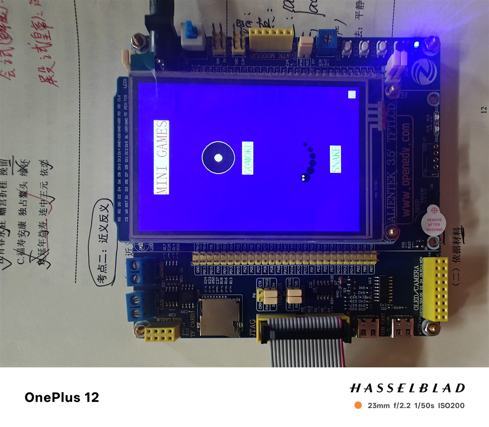
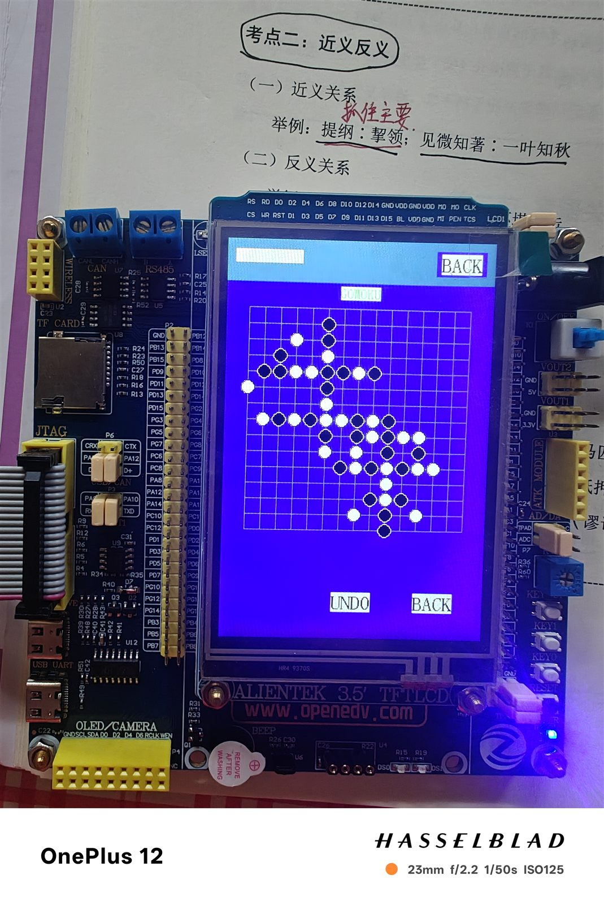
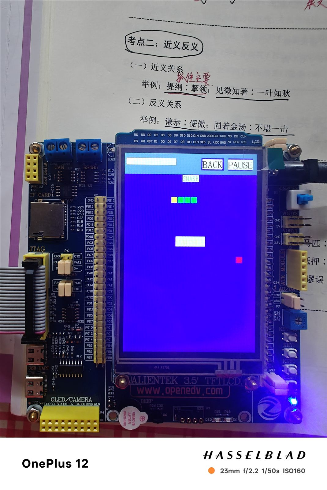

# 🎮 STM32 掌上双游戏机（五子棋 + 贪吃蛇）

    

> 基于 STM32 + 3.5 寸触摸屏的掌上双游戏机，全触摸操作，纯裸机实现 🕹️

## 这是什么？

一个可以在 STM32 开发板上运行的**双游戏机**，包含五子棋和贪吃蛇两个经典游戏。主菜单一键切换，全程触摸操作，无操作系统依赖。

**适合场景**：
- 🎓 学习 STM32 裸机开发
- 🕹️ 了解触摸屏交互设计
- 📚 学习游戏状态机与碰撞检测

## ✨ 功能特性

### 主菜单
- 🎮 GOMOKU / SNAKE 双按钮进入
- 🔄 游戏间自由返回

### ⚫ 五子棋（双人对战）
- 15×15 棋盘，黑先白后
- 触摸落子自动吸附交叉点
- 四方向五连判定，获胜高亮
- 悔棋（20 步）、重开、和棋判定

### 🐍 贪吃蛇
- 20×18 网格，吃食物加分
- 每 5 个加速 10%（300ms → 100ms）
- **最高分掉电保存**（24C02）
- 触摸方向键 + 物理按键备用

### 硬件特性
- 📱 电阻触摸屏，首次四角校准
- 💾 Flash 56KB / SRAM 3KB（资源占用小）
- 🔤 纯 ASCII 界面，不依赖字库

## 🛠️ 硬件要求

| 部件 | 说明 |
|------|------|
| 主控 | 正点原子精英版 STM32F103ZET6 |
| 屏幕 | 3.5 寸电阻触摸屏（320×480） |
| 下载器 | ST-Link（SWD） |

## 📸 实拍照片





## 📁 目录结构

```
stm32-dual-games/
├── KeilProject/
│   ├── Drivers/           # 底层驱动（LCD/TOUCH/KEY）
│   ├── User/              # 应用层
│   │   ├── main.c         # 主循环状态机
│   │   ├── menu.c         # 主菜单
│   │   ├── ui.c           # 按钮组件
│   │   ├── game_gomoku.c  # 五子棋
│   │   └── game_snake.c   # 贪吃蛇
│   └── Projects/MDK-ARM/  # Keil 工程
├── tests/                 # 主机侧游戏逻辑测试
└── images/                # 实拍照片
```

## 🚀 快速开始

### 编译与烧录

1. 安装 **Keil MDK 5.43a**（AC6 编译器）
2. 打开 `KeilProject\Projects\MDK-ARM\atk_f103.uvprojx`
3. 配置 ST-Link（SWD 模式）
4. `F7` 编译 → `F8` 下载

命令行编译：

```bat
"MDK5.36\UV4\UV4.exe" -b KeilProject\Projects\MDK-ARM\atk_f103.uvprojx -j0
```

### 操作说明

- **主菜单**：点 GOMOKU / SNAKE 进入游戏
- **五子棋**：触摸落子，RESTART 重开，UNDO 悔棋
- **贪吃蛇**：触摸方向键转向，PAUSE 暂停

## 🧪 测试

```bash
# 主机侧游戏逻辑测试（11 个用例）
py tests/test_snake_logic.py
```

## 📄 许可证

[MIT License](LICENSE) © y0u41

底层驱动基于正点原子例程，版权归广州市星翼电子科技有限公司。
